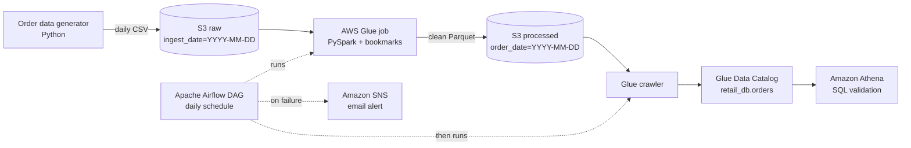

# Incremental Batch ETL Pipeline on AWS (Glue · S3 · Athena · Airflow)

A daily batch pipeline for retail order data. New files land in an S3 raw zone, an AWS Glue
PySpark job processes **only the new files** (job bookmarks), cleans and validates them, writes
partitioned Parquet, and a Glue crawler registers the table for SQL analysis in Athena.
Apache Airflow orchestrates the job and crawler on a daily schedule, with SNS failure alerts.

## Architecture



## Tech stack

| Area | Tools |
|---|---|
| Storage | Amazon S3 (versioning, lifecycle rules, SSE-S3 encryption) |
| Processing | AWS Glue 5.1 (PySpark), Glue job bookmarks |
| Catalog & query | Glue crawler, Glue Data Catalog, Amazon Athena |
| Orchestration | Apache Airflow 3 (Amazon provider: Glue job and crawler operators) |
| Alerting | Amazon SNS (email on task failure) |
| Security | IAM roles with least privilege, no hard-coded credentials |
| Language | Python, SQL |

## What the pipeline does

1. **Ingest:** each day's orders arrive as one CSV in `raw/orders/ingest_date=YYYY-MM-DD/`
2. **Incremental read:** Glue job bookmarks process only files not seen in earlier runs
3. **Clean and validate:**
   - Cast text columns to proper types (int, double, timestamp)
   - Drop rows with missing `customer_id` or non-positive `quantity`
   - Remove duplicate `order_id`s
   - Standardize `order_status` (trim + lowercase)
   - Add `processed_at` audit timestamp
4. **Load:** write Parquet partitioned by **order (event) date**, not arrival date, so late
   orders land in the correct day
5. **Catalog:** crawler updates `retail_db.orders` with new partitions
6. **Orchestrate:** Airflow runs job → crawler daily; the crawler runs only if the job succeeds

## Results

| Test | Evidence |
|---|---|
| **Incremental loading** | Successive runs read 50 → 500 → 1,005 rows, each skipping already-processed files |
| **Empty-day safety** | A run with no new files read 0 rows, skipped the write, and the table count stayed unchanged |
| **Data quality** | A batch of 1,005 raw rows with 37 missing customers, 12 invalid quantities, 5 duplicates and inconsistent statuses produced **951 clean rows with zero defects** |
| **Reconciliation** | Row counts match across source files, Glue logs (CloudWatch) and Athena |
| **Partition pruning** | Filtering one day in Athena scanned only 5.58 KB |
| **Orchestration** | Airflow scheduled and manual runs completed job → crawler end to end |

## Repository layout

```
├── generate_orders_data.py          # daily order data with planted defects
├── glue/orders_batch_etl.py          # Glue PySpark ETL job
├── airflow_orders/
│   ├── dags/orders_pipeline.py       # Airflow DAG: Glue job → crawler, SNS alerts
│   └── requirements.txt
└── sql/validation_queries.sql        # Athena data quality checks
```

## How to run

**1. Generate and upload a daily batch**
```bash
python3 generate_orders_data.py 2026-10-12 1000
aws s3 cp orders_2026-10-12.csv s3://<your-bucket>/raw/orders/ingest_date=2026-10-12/
```

**2. Run Airflow locally**
```bash
cd airflow_orders
python3.12 -m venv myenv && source myenv/bin/activate
pip install "apache-airflow[amazon]==3.3.2" \
  --constraint "https://raw.githubusercontent.com/apache/airflow/constraints-3.3.2/constraints-3.12.txt"
export AIRFLOW_HOME=$(pwd)
airflow standalone
```
Open http://localhost:8080, enable `orders_batch_pipeline` and trigger it.

**3. Validate in Athena** using the queries in `sql/validation_queries.sql`.

## Design decisions

- **Bookmarks over full reloads:** reprocessing only new files keeps run time and cost flat as data grows
- **Partition by event date:** business questions are about when orders happened, not when files arrived
- **Parquet:** columnar and compressed, so Athena scans far less data than CSV
- **Raw zone is immutable:** bad rows are filtered out of the processed zone, never deleted from raw, so data can always be reprocessed
- **Least-privilege IAM:** the Glue role can access only this project's bucket

## Possible improvements

- Write rejected rows to a quarantine table with a rejection reason
- Replace manual Athena checks with Glue Data Quality rules
- Make writes idempotent with partition overwrite or Apache Iceberg `MERGE`
- Deploy infrastructure with Terraform and CI/CD with GitHub Actions